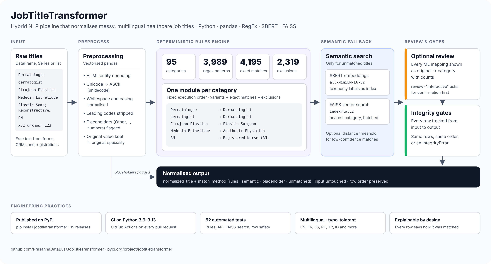

# JobTitleTransformer

[](https://github.com/PrasannaDataBus/JobTitleTransformer/actions/workflows/ci.yml) [](https://pypi.org/project/jobtitletransformer/) [](https://pypi.org/project/jobtitletransformer/)



**JobTitleTransformer** is a hybrid `NLP pipeline` that ingests, sanitizes and normalizes highly unstructured, multilingual healthcare job titles into a standardized taxonomy of 100 labels.

Built for `ETL workflows`, it delivers high-quality `Data Modeling` for downstream platforms such as `Data Lakes`, `Data Hubs`, `Data Warehouses`, `Data Marts` and `Semantic Models`.

```python
import JobTitleTransformer as jtt

jtt.normalize_title("Dermatologue")        # 'Dermatologist'
jtt.normalize_title("Cirujano Plastico")   # 'Plastic Surgeon'
jtt.normalize_title("dermatogist")         # 'Dermatologist'
```

## ✨ Highlights

* **95 curated rule modules** with ~4,000 RegEx patterns, ~4,200 exact matches and ~2,300 exclusions for spellings, typos, abbreviations and translations (English, French, Spanish, Portuguese, Turkish, Indonesian and more).
* **Semantic fallback** with SBERT embeddings and FAISS search for titles the rules have never seen.
* **Explainable output:** every row says how it was matched (`rules`, `semantic`, `placeholder` or `unmatched`).
* **Safe by design:** the input is never modified, row order and index are preserved, and no row is ever dropped.
* **Works with any DataFrame and any column name**, a pandas Series, a list, or a single string.

---

## ⚙️ Installation

```bash
pip install jobtitletransformer
```

Requires Python 3.9+. All dependencies, including `sentence-transformers` and `faiss-cpu` for the semantic stage, install automatically. The embedding model is downloaded on first use.

---

## 🚀 Quickstart

```python
import pandas as pd
import JobTitleTransformer as jtt

contacts = pd.read_csv("contacts.csv")

clean = jtt.normalize(contacts, column="job_title")
```

`clean` is a copy of `contacts` with two new columns:

| job_title | normalized_title | match_method |
|---|---|---|
| Dermatologue | Dermatologist | rules |
| Plastic &amp;amp; Reconstructive Surgeon | Plastic and Reconstructive Surgeon | rules |
| RN | Registered Nurse (RN) | rules |
| Other | *None* | placeholder |
| Longevity Doctor | *nearest taxonomy label* | semantic |

| `match_method` | Meaning |
|---|---|
| `rules` | Matched by a curated rule: deterministic and explainable |
| `semantic` | Matched by the SBERT + FAISS fallback: worth reviewing |
| `placeholder` | Not a job title ("Other", "-", bare numbers…), left empty on purpose |
| `unmatched` | No confident match (semantic stage disabled or above the threshold) |

### Options

```python
clean, report = jtt.normalize(
    contacts,
    column="job_title",
    semantic=True,              # use the SBERT + FAISS fallback (default)
    semantic_threshold=None,    # max L2 distance to accept a semantic match; None = always take the nearest
    review="none",              # "interactive" prints semantic matches and asks for confirmation
    verbose=False,              # True shows the rule engine's detailed diagnostics
    return_report=True,
)

print(report)                   # counts per match method
report.semantic_matches         # DataFrame of original → normalized semantic matches, with counts
report.unmatched                # titles that could not be matched
```

Use `semantic=False` for a fast, fully deterministic run with no model download.

The 100 standard labels are available as `jtt.TAXONOMY_LABELS`.

### Upgrading from `run_pipeline`

`run_pipeline(df)` still works and now preserves row order, but it is deprecated. Replace it with:

```python
clean = jtt.normalize(df, column="speciality", review="interactive")
```

---

## 🏗️ Pipeline Architecture

The engine runs a deterministic-to-probabilistic cascade to balance speed, precision and recall:

1. **Vectorized Text Preprocessing:** HTML entity decoding, Unicode normalization (`NFKD`, `unidecode`), whitespace and punctuation clean-up, and detection of placeholder values.

2. **Deterministic Rules Engine:** 95 modular taxonomy scripts, executed in a fixed order, combine RegEx variants, exact-match dictionaries and exclusions for precise mapping of known variants, typos and edge cases.

3. **Machine Learning Semantic Search (Fallback):** Titles the rules do not recognise are embedded with SBERT (`all-MiniLM-L6-v2`) and matched to the nearest taxonomy label with an L2 vector search in `FAISS`. An optional distance threshold keeps low-confidence matches out.

4. **Data Integrity by Design:** every input row is tracked from start to finish, so the output always has exactly the same rows, in the same order, as the input.

> ⚠️ **Domain constraint:** the taxonomy and rules are optimized for the **healthcare and medical sectors**.

---

## 🧪 Testing

The rule engine, the public API and the FAISS search path are covered by an automated test suite. GitHub Actions runs it on every pull request across Python 3.9–3.13 and verifies that the package builds.

```bash
pip install pandas termcolor tabulate unidecode numpy faiss-cpu pytest
pip install --no-deps -e .
pytest
```

See [CHANGELOG.md](CHANGELOG.md) for release notes.

---

🧠 Author & Maintainer

Prasanna - Senior Data Engineer & Analytics Specialist

📧 prasannadatabuss@gmail.com

🌐 GitHub: PrasannaDataBus
